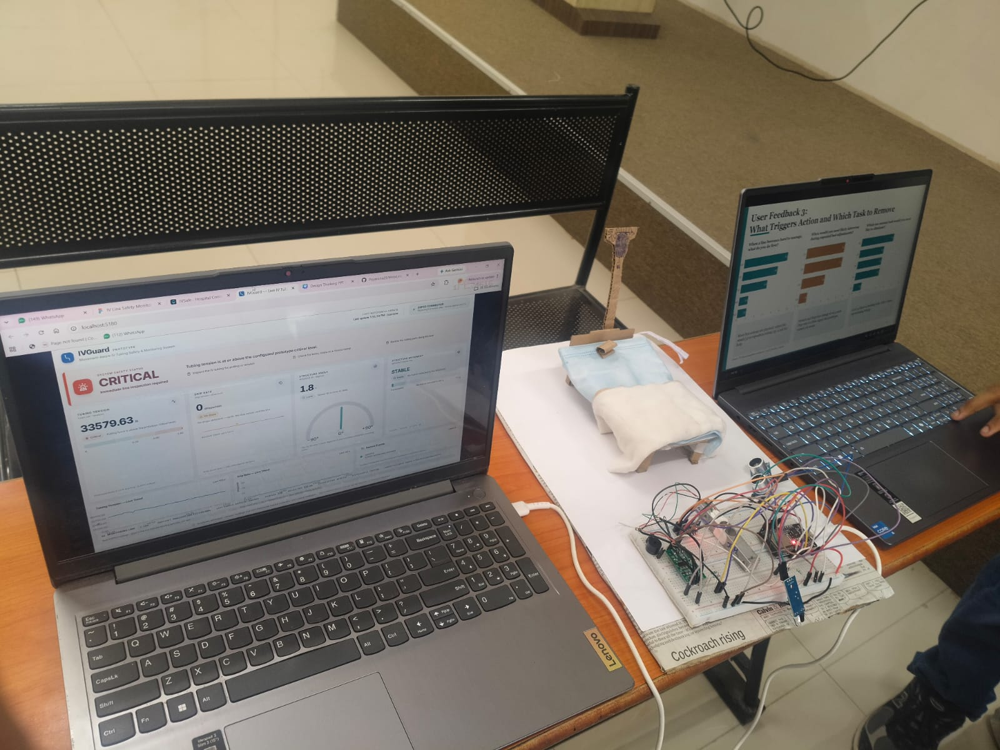
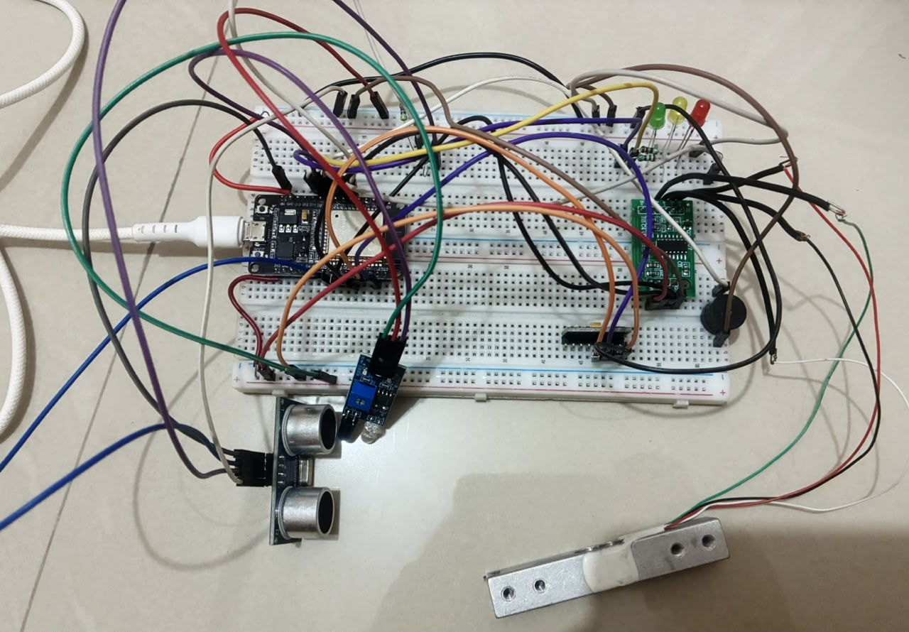
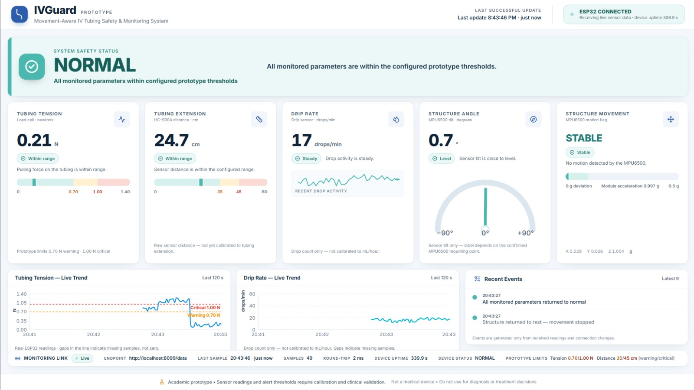
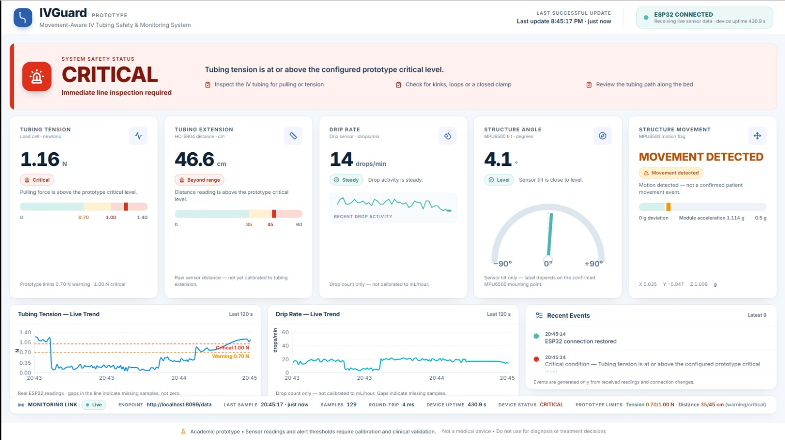
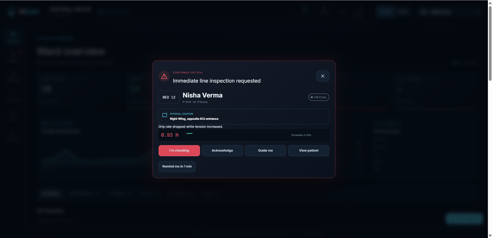
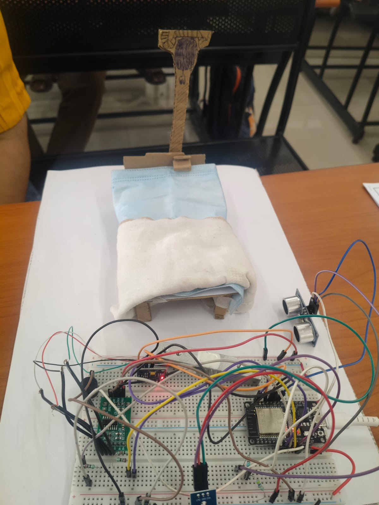

# IVSafe — Motion-Aware IV Tubing Alert System

<p align="center">
  <strong>An ESP32-Based Sensor Interfacing and Real-Time IV Tubing Monitoring Prototype</strong>
</p>

<p align="center">
  
</p>

<p align="center">
  <em>Making IV tubing disturbances more visible through embedded sensing, wireless communication, and real-time monitoring.</em>
</p>

<p align="center">
  
  
  
  
</p>

---

## Table of Contents

- [Overview](#overview)
- [The Problem We Aim to Address](#the-problem-we-aim-to-address)
- [Our Approach](#our-approach)
- [Project Objectives](#project-objectives)
- [System Architecture](#system-architecture)
- [Hardware Components](#hardware-components)
- [Sensor Interfacing and Working Principles](#sensor-interfacing-and-working-principles)
- [ESP32 Firmware and Embedded Logic](#esp32-firmware-and-embedded-logic)
- [Wireless Data Transmission](#wireless-data-transmission)
- [Dashboard and Real-Time Monitoring](#dashboard-and-real-time-monitoring)
- [Alert Generation](#alert-generation)
- [Prototype Demonstration](#prototype-demonstration)
- [Technology Stack](#technology-stack)
- [Setup and Usage](#setup-and-usage)
- [Current Capabilities](#current-capabilities)
- [Limitations](#limitations)
- [Future Scope](#future-scope)
- [Conclusion](#conclusion)
- [Team](#team)

---

## Overview

**IVSafe (Motion-Aware IV Tubing Alert System)** is an academic engineering prototype designed to demonstrate how embedded systems and sensor interfacing can help monitor disturbances around an intravenous (IV) tubing setup.

During patient movement or bed repositioning, IV tubing may experience pulling, displacement, or changes in its physical arrangement. Such disturbances can be difficult to observe continuously, particularly when healthcare personnel are monitoring multiple patients.

IVSafe explores a technology-assisted approach: sensors collect physical measurements, an ESP32 processes the readings, and a Wi-Fi-connected dashboard presents the information in an accessible format. Configurable rules classify selected readings into prototype status levels, helping demonstrate how a monitoring system could draw attention to conditions that warrant human inspection.

The project brings together **microcontrollers, sensor interfacing, embedded programming, wireless communication, data processing, and a real-time visual interface** in one integrated prototype.

> **Our central idea:** Convert physical changes around IV tubing into measurable signals, then communicate those signals clearly enough to support timely human attention.

**Important:** IVSafe is a student prototype, not a certified medical device. Its readings and thresholds have not been clinically validated and must not be used to make diagnosis or treatment decisions.

## The Problem We Aim to Address

IV tubing forms an important physical connection in an infusion setup. Changes in its position or tension can create situations that deserve inspection.

Potential challenges include:

- **Tubing disturbance:** Patient movement or bed repositioning may alter the tubing's physical arrangement.
- **Unnoticed pulling:** A line may experience increased tension without the change being immediately apparent to a caregiver.
- **Changes in drop activity:** A change in the observed drip count may indicate that the infusion setup needs checking, although the count alone cannot establish the cause.
- **Limited continuous visibility:** Staff may not be able to observe every physical change in a line at every moment.

A conventional setup does not necessarily provide an electronic view of these physical changes. IVSafe investigates whether multiple inexpensive sensors and a microcontroller can make selected changes measurable and visible.

The objective is not to replace nursing observation or clinical equipment. It is to demonstrate an embedded monitoring concept that combines several signals into one interface.

## Our Approach

IVSafe uses an ESP32 as the central controller for a set of sensors connected to a prototype IV-line monitoring arrangement.

The system collects measurements associated with tubing tension, sensor-to-target distance, drop activity, and structural movement or tilt. It then makes the readings available to a browser-based dashboard over Wi-Fi.

The dashboard presents the latest received values, highlights configured prototype alert conditions, and displays trends and recent events. When communication is interrupted, it distinguishes stale or unavailable data from a healthy live connection instead of presenting old readings as current.

The project therefore has two closely connected parts:

1. **Embedded monitoring unit:** Acquires sensor data, performs the relevant calculations, and serves readings from the ESP32.
2. **Monitoring dashboard:** Receives the readings, evaluates presentation-level status rules, and displays measurements, trends, and connection health.

## Project Objectives

- Interface multiple sensors with an ESP32 microcontroller.
- Demonstrate digital and I²C-based sensor communication, along with load-cell signal acquisition.
- Measure and display changes in selected physical parameters.
- Implement embedded logic for motion detection and threshold-based alerts.
- Transfer sensor readings wirelessly using Wi-Fi and HTTP.
- Expose sensor readings through a JSON-based endpoint.
- Build a dashboard that updates automatically with incoming readings.
- Demonstrate connection-loss handling and distinguish missing data from valid measurements.
- Explore how embedded monitoring can make physical disturbances easier to notice.

## System Architecture

<p align="center">
  
</p>

The system follows a sensor-to-dashboard data pipeline.

```text
       PHYSICAL IV-LINE SETUP
                  |
                  v
       +----------------------+
       |    Sensor Layer      |
       |                      |
       | Load Cell + HX711    |
       | HC-SR04              |
       | MPU6500               |
       | IR Drip Sensor       |
       +----------------------+
                  |
                  v
       +----------------------+
       |        ESP32         |
       |                      |
       | Sensor Acquisition   |
       | Embedded Processing  |
       | Threshold Evaluation |
       | Wi-Fi Connectivity   |
       | HTTP Web Server      |
       +----------------------+
                  |
           Wi-Fi / HTTP
                  |
                  v
       +----------------------+
       |   GET /data Endpoint |
       |      JSON Payload    |
       +----------------------+
                  |
                  v
       +----------------------+
       |   Browser Dashboard  |
       |                      |
       | Live Measurements    |
       | Status Classification|
       | Trend Charts         |
       | Recent Events        |
       | Connection Health     |
       +----------------------+
```

**Key design principle:** The ESP32 is responsible for interfacing with the physical sensors and serving the measurements. The browser dashboard is responsible for presenting the data and applying additional display-level advisories. This separation keeps hardware acquisition distinct from the user interface.

## Hardware Components

| Component | Purpose in IVSafe |
|---|---|
| ESP32 development board | Main microcontroller, sensor coordination, embedded processing, Wi-Fi connectivity, and HTTP server |
| Load cell | Converts applied mechanical force into a small electrical signal |
| HX711 amplifier and ADC module | Amplifies and digitizes the load-cell signal for the ESP32 |
| HC-SR04 ultrasonic sensor | Measures distance to a target using ultrasonic pulse timing |
| MPU6500 inertial sensor | Provides accelerometer data for detecting changes in orientation and motion |
| IR drip sensor | Detects passing drops through changes in the sensor's output |
| RGB LED | Provides local visual indication of prototype status |
| Buzzer | Provides local audible alerts based on configured conditions |
| Breadboard and jumper wires | Support prototyping and electrical interconnections |
| Laptop or monitor | Displays the browser-based monitoring dashboard |

The components collectively demonstrate the integration of analog sensing, digital inputs, I²C communication, timing-based measurement, and wireless networking.

## Sensor Interfacing and Working Principles

### 1. Load Cell and HX711 — Tubing Tension

A load cell changes its electrical characteristics when a mechanical force is applied. In many load cells, this is achieved using strain gauges arranged in a Wheatstone bridge.

The resulting signal is very small and is not suitable for direct, accurate measurement using an ordinary microcontroller GPIO. The HX711 module provides amplification and high-resolution analog-to-digital conversion for the load-cell signal.

**Working sequence:**

1. A force is applied to the load cell through the prototype's mechanical arrangement.
2. The load cell produces a small differential electrical signal.
3. The HX711 amplifies and converts that signal into digital measurements.
4. The ESP32 reads the HX711 output through its digital data and clock connections.
5. Firmware applies tare and calibration settings to calculate a force estimate.
6. The resulting value is sent to the dashboard for display and comparison against configured prototype thresholds.

The dashboard expresses the result in newtons (N).

**Important calibration note:** The load cell must be calibrated using known loads and an appropriate mechanical arrangement before its readings can be treated as meaningful force measurements. An uncalibrated conversion factor can produce incorrect values. The displayed alert limits are demonstration thresholds, not medically established limits.

### 2. HC-SR04 — Ultrasonic Distance Measurement

The HC-SR04 measures distance by transmitting an ultrasonic pulse and timing the returning echo.

**Working sequence:**

1. The ESP32 generates a short trigger pulse.
2. The HC-SR04 emits an ultrasonic burst.
3. The echo output indicates the time taken for the reflected sound to return.
4. The ESP32 measures the echo duration.
5. Firmware estimates the distance using the speed of sound.

The underlying relationship is:

\[
d = \frac{v \times t}{2}
\]

Where:

- \(d\) is the estimated distance.
- \(v\) is the speed of sound in air.
- \(t\) is the measured round-trip travel time.
- Division by two accounts for the outgoing and returning paths.

The dashboard uses this measurement to represent the sensor's distance from its target.

**Important distinction:** Raw sensor-to-target distance is not automatically the same as tubing extension or reel payout. A calibrated mechanical relationship is needed before the reading can accurately represent the length of tubing released.

The HC-SR04 operates at a 5 V supply in typical modules, while the ESP32 uses 3.3 V GPIO logic. Its ECHO output must therefore be reduced to a safe level before reaching an ESP32 input. The prototype uses a resistor divider for this purpose.

### 3. MPU6500 — Movement and Tilt Sensing

The MPU6500 is an inertial measurement sensor that includes a three-axis accelerometer and a three-axis gyroscope. IVSafe uses accelerometer measurements to demonstrate motion and orientation monitoring.

The sensor communicates with the ESP32 over the I²C bus.

| Signal | Purpose |
|---|---|
| SDA | Serial data |
| SCL | Serial clock |
| I²C address | Identifies the sensor on the shared bus |

In the prototype wiring, SDA is connected to GPIO 21 and SCL to GPIO 22.

The accelerometer measures acceleration along the X, Y, and Z axes. When the module is stationary, gravity contributes to the measured acceleration. Changes in the readings can help identify movement or changes in orientation.

Firmware can process these measurements to estimate a tilt value and determine whether a configured motion condition has occurred.

**What the result means:** The sensor detects movement of the module itself. It cannot independently confirm that a patient moved, that the IV line kinked, or that fluid flow was obstructed. The interpretation depends on the sensor's mounting position and the physical relationship between the module and the monitored structure.

### 4. IR Drip Sensor — Drop Activity

The IR drip sensor detects passing drops through changes in its optical sensing output.

When a drop passes through the sensing region, the output changes. The ESP32 detects the relevant transition and counts the events.

If \(N\) drops are counted over a measurement interval of \(T\) seconds, the estimated drop rate is:

\[
R = \frac{60N}{T}
\]

Where \(R\) is the drop count per minute.

For example, if 10 drops are detected over 30 seconds:

\[
R = \frac{60 \times 10}{30} = 20
\]

The estimated rate is 20 drops/min.

This is a drop-count measurement, not a direct measurement of volumetric flow in mL/hour. Converting drops into volume would require a known and appropriate drop factor and a validated measurement arrangement. The sensor also cannot identify the cause of a drop-rate change on its own.

### 5. RGB LED and Buzzer — Local Indication

The RGB LED and buzzer provide local feedback from the embedded unit.

- The RGB LED can indicate normal, warning, or critical prototype states.
- The buzzer can provide an audible indication when configured alert conditions are met.

These outputs demonstrate how a microcontroller can respond locally to sensor readings, independently of the browser dashboard.

Their exact behaviour depends on the thresholds and conditions implemented in the firmware.

## ESP32 Firmware and Embedded Logic

The ESP32 firmware coordinates sensor acquisition, data processing, alert logic, and wireless communication.

Its major responsibilities include:

1. Initializing GPIO pins and communication interfaces.
2. Establishing I²C communication with the MPU6500.
3. Initializing the HX711 interface and applying tare/calibration settings.
4. Triggering ultrasonic measurements and calculating distance.
5. Reading the IR sensor and counting detected drops.
6. Processing accelerometer data to estimate movement and tilt.
7. Evaluating configured prototype alert conditions.
8. Updating the local LED and buzzer outputs.
9. Maintaining a Wi-Fi connection and serving sensor readings through an HTTP endpoint.

### Embedded communication interfaces

The project demonstrates several common microcontroller interfacing concepts:

- **GPIO:** Digital inputs and outputs, including the IR sensor and local indicators.
- **I²C:** Communication between the ESP32 and MPU6500 using SDA and SCL.
- **Digital clock/data interface:** Communication with the HX711 module.
- **Pulse timing:** Measuring the HC-SR04 echo duration.
- **Wi-Fi:** Wireless network connectivity.
- **HTTP:** Request-response communication between the dashboard and the ESP32.

### Why use an ESP32?

The ESP32 combines general-purpose input/output, serial communication peripherals, processing capability, and built-in Wi-Fi. This allows the prototype to collect sensor readings and make them available to a browser without requiring a separate Wi-Fi module.

The microcontroller is therefore both the hardware interface and the network-connected data source.

## Wireless Data Transmission

One of the central features of IVSafe is the transfer of sensor readings directly from the ESP32 to the dashboard.

The system uses a lightweight HTTP request-response approach rather than requiring a separate cloud server for the basic local demonstration.

### How the data travels

1. **Sensor acquisition:** The ESP32 reads the connected sensors.
2. **Data processing:** Firmware converts the readings into values such as force estimates, distance, drop rate, and motion status.
3. **JSON construction:** The firmware packages the latest values into a JSON object.
4. **HTTP server:** The ESP32 exposes the object through its `/data` endpoint.
5. **Dashboard polling:** The browser periodically sends an HTTP GET request to that endpoint.
6. **Parsing:** The dashboard receives the response and parses the JSON.
7. **Rendering:** The interface updates the measurement panels, trends, connection indicators, and status banner.

The data path is:

```text
Sensor → ESP32 firmware → JSON → HTTP GET /data
                                      |
                                      v
                           Browser receives response
                                      |
                                      v
                            JSON parsing and validation
                                      |
                                      v
                             Dashboard state updates
                                      |
                                      v
                             Updated visual readings
```

### What is JSON?

JSON (JavaScript Object Notation) is a text-based format for representing structured data. It allows the ESP32 to send named fields and their values in a format that browser-based JavaScript can parse easily.

A simplified example of the expected payload is:

```json
{
  "timestamp": 183421,
  "tension": 0.42,
  "extension": 28.5,
  "bed_angle": 1.1,
  "drip_rate": 18,
  "movement": false,
  "acceleration": 1.002,
  "accel_x": 0.021,
  "accel_y": -0.014,
  "accel_z": 1.001,
  "status": "NORMAL"
}
```

These values are illustrative. Actual values depend on the physical setup, sensor calibration, and firmware.

### What does the `/data` endpoint do?

The endpoint exposes the latest measurements through an HTTP route. A browser or another compatible client can request the route and receive a JSON response.

For example:

```http
GET /data
```

The dashboard uses the ESP32's network address as the API base URL and appends `/data` when needed.

### Why poll the endpoint periodically?

The dashboard requests updated data at a short, regular interval. In the current dashboard design, polling occurs approximately every 750 milliseconds.

Polling lets the browser repeatedly retrieve the latest readings without refreshing the page manually.

It is important to distinguish polling frequency from actual sensor sampling frequency. The dashboard can only display new information as frequently as the firmware produces updated measurements and the endpoint returns them.

### Why is CORS relevant?

Browsers enforce Cross-Origin Resource Sharing (CORS) rules. If the dashboard and ESP32 endpoint have different origins, the browser may block the request unless the ESP32 responds with appropriate CORS headers.

The firmware should provide the required headers, including:

```http
Access-Control-Allow-Origin: *
```

The server should also handle any required `OPTIONS` preflight request. CORS is a browser permission mechanism; it does not itself provide authentication or network security.

### What happens if the ESP32 disconnects?

A monitoring interface should not mistake an old reading for a current one.

IVSafe includes connection and stale-data handling:

- **Live:** A recent valid response has been received.
- **Data stale:** The endpoint has stopped returning recent valid samples.
- **Connection lost:** The device cannot be reached.
- **Not configured:** The dashboard has not been given a usable endpoint.

The dashboard can retain the last known values for context, but it labels them as stale instead of claiming they are live.

This distinction is important because a frozen display must not look like a functioning monitoring system.

## Dashboard and Real-Time Monitoring

The IVSafe dashboard is designed to make the sensor readings understandable without requiring the viewer to inspect the serial output or interpret raw electrical signals.

<p align="center">
  
</p>

<p align="center">
  <em>Normal-state dashboard: measurement panels and live trends.</em>
</p>

### Main monitoring panels

| Dashboard panel | Information displayed |
|---|---|
| Tubing tension | Load-cell force estimate in newtons |
| Distance / extension | HC-SR04 distance reading; tubing extension requires calibration |
| Drip rate | Detected drops per minute |
| Structure angle | MPU6500-derived tilt estimate |
| Structure movement | Module movement status |
| System status | Current prototype alert classification |
| Live trend charts | Recent tension and drip-rate readings |
| Recent events | Selected reading changes and connection events |
| Device link status | Availability and freshness of incoming data |

### Why use a visual dashboard?

A collection of raw serial readings is useful during development, but it is not ideal for quickly understanding system behaviour.

The dashboard adds context through units, labels, colour-coded status indicators, trend charts, and connection information. It is designed to communicate the state of the prototype at a glance.

The dashboard also distinguishes sensor readings from interpretations. For example, a movement flag means that movement was detected by the sensor logic; it does not prove that a patient moved or that an IV complication occurred.

### Critical-state example

<p align="center">
  
</p>

<p align="center">
  <em>Critical-state dashboard: an illustrative prototype alert triggered by configured rules.</em>
</p>

The interface highlights readings that cross configured demonstration thresholds. The alert is intended to demonstrate how sensor information can be translated into an understandable prompt for human inspection.

**A critical dashboard state is not a clinical diagnosis.** The threshold values are experimental settings and require proper calibration and validation before any real-world application could be considered.

### Patient detail and alert interface

<p align="center">
  
</p>

The patient detail concept demonstrates how an alert can be associated with a particular monitoring view. Any patient names, bed numbers, or clinical details shown in demonstration screens should be treated as illustrative interface data, not actual patient records.

### Alert notification concept

<p align="center">
  
</p>

The notification interface explores how an elevated prototype status might be brought to a caregiver's attention. The actions and escalation shown in a UI mock-up do not imply that a real hospital alerting or escalation service is deployed.

## Prototype Demonstration

<p align="center">
  
</p>

<p align="center">
  
</p>

The physical prototype combines the ESP32, sensor modules, breadboard connections, and supporting circuitry. It is used to demonstrate the relationship between changes in the physical setup, sensor measurements, embedded processing, and the displayed results.

A typical demonstration sequence is:

1. Power the ESP32 and initialize the connected sensors.
2. Confirm that the ESP32 establishes its Wi-Fi connection.
3. Open the dashboard with the correct endpoint configured.
4. Verify that the dashboard reports a live connection.
5. Observe how the readings respond to controlled changes in the demonstration setup.
6. Observe the corresponding trends and prototype status changes.
7. Interrupt the network connection in a controlled test and verify that the dashboard indicates stale or unavailable data.
8. Restore the connection and confirm that valid readings resume.

The purpose of this sequence is to demonstrate the complete data path, not to reproduce or validate a clinical infusion event.

## Technology Stack

### Hardware and embedded systems

- ESP32 development board
- HX711 load-cell interface
- Load cell
- HC-SR04 ultrasonic distance sensor
- MPU6500 inertial sensor
- IR drip sensor
- RGB LED and buzzer
- Arduino-style embedded C/C++ firmware

### Communication

- Wi-Fi
- HTTP
- JSON
- Browser-based polling
- CORS handling for cross-origin requests

### Dashboard

- React
- TypeScript
- Vite
- Tailwind CSS
- Recharts
- Lucide React

The dashboard's data-fetching and processing logic is separated from its presentation components, making the system easier to maintain and extend.

## Setup and Usage

### 1. Prepare the hardware

Connect the ESP32 to the sensors according to the firmware's pin configuration. Check the supply voltage, common ground, signal levels, and wiring before powering the circuit.

The HC-SR04 ECHO output requires level reduction before connection to an ESP32 GPIO. Verify the load-cell wiring and the HX711 connections, and confirm the MPU6500's I²C communication.

### 2. Upload the firmware

Open the firmware in the Arduino development environment, select the appropriate ESP32 board and serial port, configure Wi-Fi credentials locally, and upload the code.

Do not publish Wi-Fi passwords or other private credentials in the repository.

### 3. Connect the ESP32 to Wi-Fi

The ESP32 and the computer running the dashboard must be able to communicate over the same reachable network. A compatible phone hotspot can be used for a local demonstration.

Open the Serial Monitor at the baud rate configured in the firmware and note the IP address printed after Wi-Fi connection succeeds.

### 4. Verify the endpoint

Open the following address in a browser, replacing the placeholder with the actual ESP32 IP address:

```text
http://<ESP32_IP>/data
```

A successful response should display a JSON object containing the sensor fields.

If the endpoint does not load, check Wi-Fi connectivity, the printed IP address, the HTTP server initialization, and whether the computer and ESP32 are on the same reachable network.

### 5. Configure the dashboard

Install the dashboard dependencies:

```bash
npm install
```

Set the dashboard's API base URL to the actual ESP32 address. For a Vite development setup, the `.env.local` file can contain:

```env
VITE_API_BASE=http://<ESP32_IP>
```

Start the development server:

```bash
npm run dev
```

Open the local URL printed by Vite. The dashboard should request data from the ESP32's `/data` endpoint.

**Note:** The repository's current dashboard also supports a runtime endpoint override through `public/config.js`. Follow the existing configuration in the source code if you are using a built deployment.

### 6. Verify live operation

Before the demonstration, confirm that:

- The dashboard reports a live ESP32 connection.
- The displayed readings change when the relevant sensor input changes.
- Units and values correspond to the expected payload fields.
- Prototype warning and critical states respond to their configured rules.
- Disconnecting the ESP32 produces a stale or connection-lost state.
- Reconnecting the device restores valid incoming readings.

The browser must be able to reach the ESP32 endpoint. A dashboard hosted on a remote HTTPS server may encounter mixed-content, browser permission, or network-routing restrictions when trying to fetch a local HTTP endpoint. A locally served dashboard is generally the simplest arrangement for an academic demonstration.

## Current Capabilities

The current prototype demonstrates the following capabilities:

- Multiple sensor interfaces coordinated by a single ESP32.
- Load-cell signal acquisition through the HX711.
- Ultrasonic distance estimation using pulse timing.
- I²C communication with the MPU6500.
- Drop-event detection using an IR sensor.
- Embedded processing and configured local alert outputs.
- Wi-Fi connectivity and an HTTP JSON endpoint.
- Automatic dashboard polling and live measurement updates.
- Trend visualizations and recent-event display.
- Connection-loss and stale-data handling.
- Threshold-based prototype status classification.

These are engineering capabilities demonstrated by the prototype. They should not be interpreted as proof of clinical accuracy, reliable detection of every IV-line disturbance, or suitability for patient care.

## Limitations

A responsible engineering prototype should make its limitations explicit.

### Calibration

The load cell requires calibration, and the ultrasonic distance measurement requires a known geometry before it can represent tubing payout. Displayed values are only as meaningful as the sensing arrangement and calibration behind them.

### Drip-rate interpretation

The IR sensor counts drops per minute. It does not directly measure volumetric flow in mL/hour, and drop counts alone cannot establish whether a line is blocked or why the observed rate changed.

### Movement interpretation

The MPU6500 measures motion and orientation of its own module. It cannot independently distinguish patient movement from movement of the bed, support, or sensor mounting.

### Threshold selection

The alert thresholds are demonstration values. They have not been established through clinical testing and must not be treated as medically recommended limits.

### Communication reliability

Wi-Fi connectivity and HTTP polling depend on network availability. Connection loss, delayed samples, and stale readings must be handled explicitly.

### Clinical safety

The prototype is not a medical device and has not been validated for clinical use. It must not be connected to or relied upon for real patient treatment or used to make medical decisions.

## Future Scope

Potential future improvements include:

- **Calibration and measurement validation:** Establish repeatable calibration procedures for the load cell and distance sensor.
- **Improved mechanical integration:** Develop a stable, purpose-built mounting arrangement that measures the intended physical quantities more directly.
- **Sensor fusion:** Investigate how multiple sensor readings can be combined to distinguish ordinary movement from potentially relevant tubing disturbances.
- **Improved filtering:** Evaluate noise reduction, signal smoothing, debouncing, and outlier rejection.
- **Robust event detection:** Test alert logic across controlled scenarios, including transient readings and communication interruptions.
- **Network resilience:** Add stronger reconnect behaviour and investigate local buffering or alternative communication methods.
- **Data logging:** Store timestamped readings for repeatable experiments and offline analysis.
- **Security:** Introduce appropriate authentication and network protection before considering use beyond a trusted demonstration network.
- **System validation:** Conduct structured bench tests and, if future development warrants it, pursue the appropriate safety, regulatory, and clinical evaluation with qualified professionals.

These extensions would help move the project from a proof-of-concept demonstration toward a more thoroughly characterized engineering system.

## Conclusion

IVSafe began with a simple concern: physical changes around IV tubing can be difficult to observe continuously, and making those changes measurable may help people understand when closer inspection is warranted.

By combining sensor interfacing, ESP32-based embedded processing, wireless HTTP communication, and a real-time dashboard, the project demonstrates how physical signals can travel from a prototype setup to a clear digital representation.

Its value lies not only in the individual sensors or the dashboard, but in the integration of the complete system: **measure, process, communicate, visualize, and indicate when a configured condition deserves attention.**

IVSafe is an exploration of how embedded engineering can be applied thoughtfully to a healthcare-related problem. It is a starting point for further calibration, testing, and validation—not a replacement for clinical judgement or established medical equipment.

---

## Team

Developed collaboratively by:

- **Jasnoor**
- **Dhakshayini**
- **Mishree**
- **Priyansha**

<p align="center">
  <strong>IVSafe — Motion-Aware IV Tubing Alert System</strong><br>
  <em>Connecting embedded sensing with meaningful, human-readable monitoring.</em>
</p>

---

<p align="center">
  <sub>Academic engineering prototype · For demonstration and educational purposes only · Not intended for clinical use</sub>
</p>
